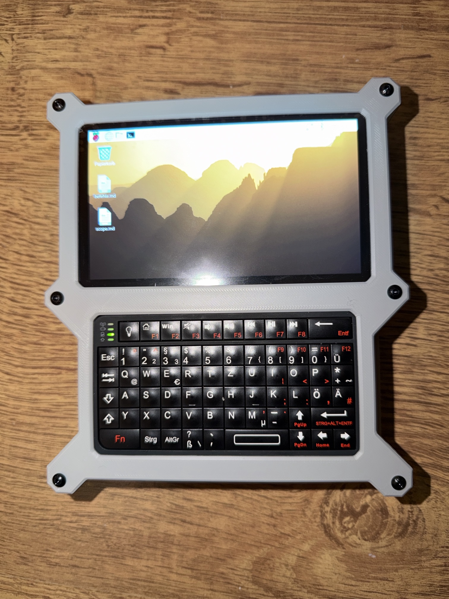

# 🛰️ Kali Cyberdeck – Raspberry Pi 5 Handheld für Security-Lab & Netzwerk-Analyse

Ein selbst gebautes, tragbares Linux-Handheld auf Basis des **Raspberry Pi 5 (8 GB)** – gedacht als mobiles Lern- und Analyse-Gerät für meinen Weg in die **DevSecOps / IT-Security**. 3D-gedrucktes Gehäuse (Design: *MadHias „Raspberry Pi5 Cyberdeck"*), selbst gedruckt auf einem Bambu Lab X1C, komplett selbst zusammengebaut, eingerichtet und dokumentiert.

> **Motivation:** Quereinsteiger aus neun Jahren Metallverarbeitung in die IT-Security. Dieses Projekt verbindet beides – handwerklicher Aufbau (Druck, Montage, Verkabelung, Troubleshooting) und der softwareseitige Betrieb eines Linux-Security-Systems. Learning by doing, von der Schraube bis zum Terminal.


*(Foto hier einfügen – das fertige Deck mit laufendem Desktop.)*

---

## Was das Gerät ist

Ein eigenständiger, akkubetriebener Mini-Rechner mit Touchscreen und physischer Tastatur, auf dem ein vollwertiges Linux mit gängigen Netzwerk- und Security-Tools läuft. Einsatzzweck: **Lernen** – Netzwerke verstehen, Dienste analysieren, Security-Konzepte praktisch nachvollziehen. Ausschließlich in eigenen Netzen oder mit ausdrücklicher, schriftlicher Erlaubnis des jeweiligen Eigentümers.

---

## 🔧 Hardware

| Komponente        | Modell                                   | Zweck                                  |
|-------------------|------------------------------------------|----------------------------------------|
| Rechner           | Raspberry Pi 5, 8 GB RAM                  | Herzstück                              |
| Kühlung           | Raspberry Pi Active Cooler               | Pflicht im geschlossenen Case         |
| Display           | Waveshare 5" DSI-TOUCH-A (720×1280, IPS) | Touchscreen, DSI-angebunden            |
| Eingabe           | Rii Mini Bluetooth-Tastatur              | Physische Tastatur im Case            |
| Strom             | USB-C Powerbank (45 W, 10.000 mAh)       | Mobiler Betrieb                        |
| Speicher          | microSDXC 128 GB (A2/U3/V30)             | System & Daten                        |
| Gehäuse           | 3D-Druck, MadHias-Cyberdeck-Design       | Selbst gedruckt (Bambu Lab X1C)       |

**Geplante Erweiterung:** Alfa AWUS036ACM (MediaTek MT7612U) – externer WLAN-Adapter mit Monitor-Mode für autorisierte WLAN-Sicherheitstests. *Das interne WLAN des Pi 5 unterstützt keinen Monitor-Mode (per `iw list` verifiziert).*

---

## 💻 Software

- **OS:** Raspberry Pi OS (64-bit)
- **Display-Anbindung:** DSI-Panel über Device-Tree-Overlay in `/boot/firmware/config.txt`
  ```
  display_auto_detect=0
  dtoverlay=vc4-kms-dsi-waveshare-panel-v2,5_0_inch_a
  ```
- **Installierte Tools (Auswahl):**
  `nmap`, `wireshark`, `tcpdump`, `aircrack-ng`, `john`, `hydra`, `nikto`,
  sowie `net-tools`, `dnsutils`, `traceroute`, `git`, `htop`, `fastfetch`

---

## 🧩 Aufbau & Troubleshooting (das eigentliche Lernen)

Der Zusammenbau war kein Plug-and-Play – und genau das war der lehrreiche Teil:

- **Gehäuse-Druck & Passung:** Teile auf dem X1C gedruckt, Standoffs und Display-Montage an das Case angepasst.
- **Display zum Laufen bringen:** Mehrtägiges Troubleshooting. Ursachen u. a.: mit einem GUI-Editor zerschossene `config.txt`, falsches Panel-Overlay, DSI-Port-Zuordnung. Gelöst durch sauberes Editieren per Terminal (`nano`/`sed`) und das korrekte Waveshare-Overlay. **Lektion:** Konfigurationsdateien nie mit einem Editor bearbeiten, der Zeilenenden/Formatierung verändert.
- **Thermik geprüft:** Unter Last 43–47 °C, `vcgencmd get_throttled` = `0x0` (kein Throttling) auch im Akkubetrieb.
- **Remote-Workflow:** Einrichtung bequem per `ssh` vom Laptop statt auf der Mini-Tastatur.

---

## 🛡️ Arbeitsweise bei Sicherheitstests (Scope-First)

Kernprinzip dieses Projekts: **Kein Test ohne vorherige, schriftliche Autorisierung.** Für jeden Test wird vorab ein Scope-Dokument ausgefüllt, das Umfang, Grenzen und Rechtslage festhält – so, wie es bei einem echten Penetrationstest Standard ist.

➡️ Vorlage: [`docs/scope-vorlage.md`](docs/scope-vorlage.md)

Festgehalten werden u. a.:
- Wer ist Auftraggeber, ist er verfügungsberechtigt über das Netz?
- Liegt die Erlaubnis schriftlich vor? (Nachweis wird abgelegt, **nie** ins Repo committet)
- Was ist **In-Scope** (genau ein Netz) und was ausdrücklich **Out-of-Scope** (alle anderen Netze, fremde Geräte)?
- Umgang mit Ergebnissen: Passwörter nur dem Eigentümer, Mitschnitte danach gelöscht.

**Rechtlicher Rahmen (DE):** Tests ausschließlich am eigenen Netz oder mit schriftlicher Erlaubnis des Eigentümers. Das Abhören oder Angreifen fremder Netze ist strafbar (§§ 202a–202c, § 303b StGB). Im Zweifel: kein Test.

---

## 📚 Was ich dabei gelernt habe

- Raspberry-Pi-Hardware, DSI-Displays und Device-Tree-Overlays
- Linux-Administration über die Shell und per SSH
- Grundlagen der Netzwerk-Analyse (Host-Discovery, Service-/Versions-Scans mit `nmap`)
- WLAN-Grundlagen: warum Monitor-Mode Hardware-abhängig ist
- **Vor allem:** die saubere, rechtssichere Arbeitsweise – Scope, Autorisierung, Dokumentation

---

## 🗺️ Roadmap

- [ ] Alfa AWUS036ACM integrieren (autorisierte WLAN-Analyse)
- [ ] Erstes dokumentiertes Lab in eigenem Netz (anonymisierter Bericht)
- [ ] Netzwerk-Segmentierungs-Case: Trennung von IoT-/Gastgeräten (Praxisprojekt)

---

## ⚠️ Disclaimer

Dieses Repository dokumentiert ein **Lernprojekt**. Alle Werkzeuge werden ausschließlich in eigenen Netzen oder mit ausdrücklicher, schriftlicher Erlaubnis des Netz-Eigentümers eingesetzt. Es werden hier keine Angriffsanleitungen, keine echten Passwörter, SSIDs, MAC-Adressen oder Mitschnitte veröffentlicht.

---

*Gebaut von Ibrahim Onat · Quereinsteiger in DevSecOps/IT-Security · Bayern*
